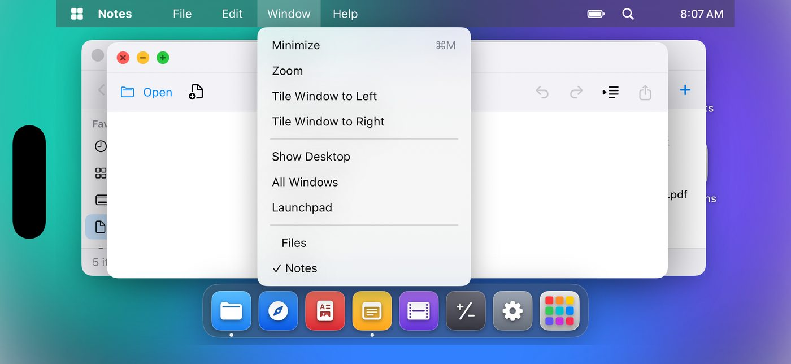
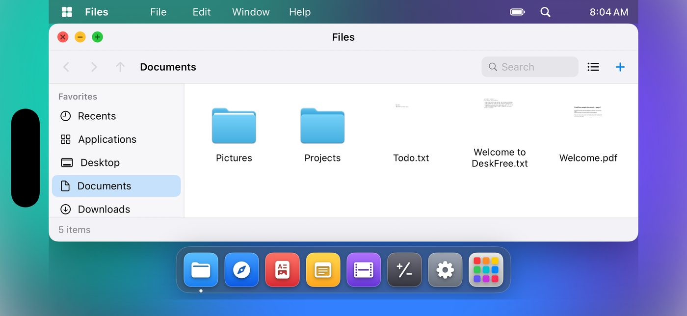
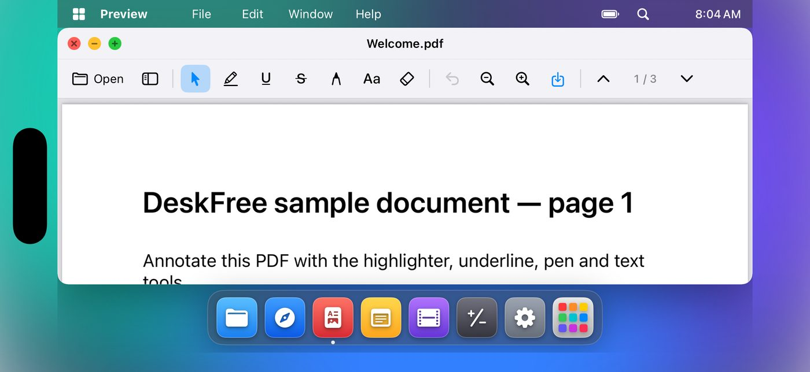
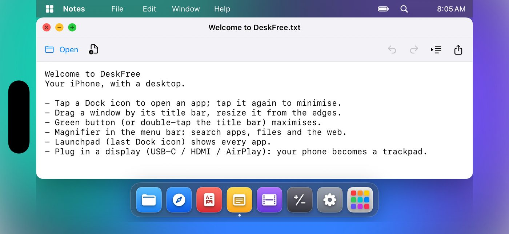
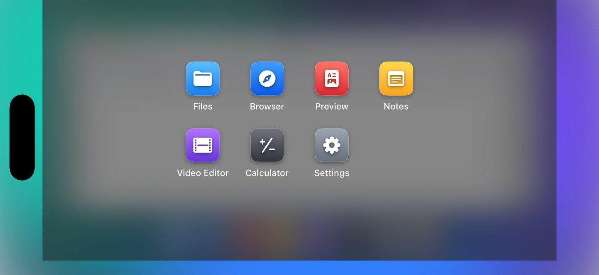
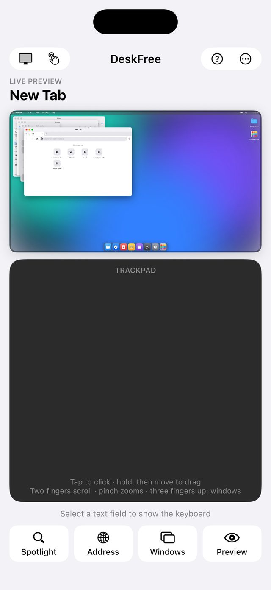

# DeskFree

**A free, open-source "desktop in your pocket" for iPhone.**
Floating, resizable windows, a Dock, desktop search, a browser, a file manager, a PDF annotator and a video editor — and when you plug in a bigger screen, your phone turns into a trackpad and keyboard.

> 🇮🇹 **In breve:** un'app iPhone gratuita e open source che porta un vero desktop a finestre sull'iPhone (menu bar, Dock, finestre mobili e ridimensionabili, ricerca, browser, file, PDF, editor video) e, collegando uno schermo esterno, trasforma l'iPhone in trackpad + tastiera. Istruzioni per compilarla e installarla sono qui sotto.

DeskFree is an **independent project**. It is inspired by the idea behind "iPhone desktop" apps, but it is written from scratch: no code, artwork, icons or text from any commercial app are used, and it is not affiliated with or endorsed by any of them.

<p align="center">
  
</p>

<table>
  <tr>
    <td></td>
    <td></td>
  </tr>
  <tr>
    <td></td>
    <td></td>
  </tr>
</table>

<p align="center">
  
</p>

*Screenshots are real captures of the app running in the iPhone simulator on GitHub Actions (see the `Screenshots` workflow).*

---

## Features

| | |
|---|---|
| **Desktop shell** | Menu bar with real **File / Edit / Window / Help** menus, clock and battery; frosted Dock with running indicators; **Launchpad**; desktop shortcuts; **all-windows switcher**; wallpapers (6 built-in + your own photo) |
| **Windows** | Drag by the title bar, resize from any edge or corner, minimise to the Dock, maximise (button or double-tap the title bar), click-to-focus stacking |
| **Search** | Spotlight-style search for apps, open windows, files in *Documents*, quick maths (`12*(3+4)`), web search or a URL |
| **Browser** | WebKit, desktop-class sites, tabs, address bar with search, progress bar, **bookmarks** |
| **Files** | Sidebar with Recents, Desktop, Documents, Downloads, **linked external folders** (iCloud Drive etc.) and a real **Trash**; grid/list, thumbnails, import, new folder, rename, duplicate, share |
| **Preview** | PDFs and pictures. PDF: thumbnails, highlight, underline, strikethrough, pen, text, eraser, undo, zoom, print. Pictures: rotate, zoom, save a copy, save to Photos, share |
| **Video Editor** | Import from Files or Photos, timeline with thumbnails, trim handles, speed (0.5–2×), filters, mute, 720p/1080p/best export to *Documents/Exports* |
| **Notes** | Plain-text editor for `.txt` / `.md` files in Documents: autosave, undo/redo, indent, export |
| **Calculator** | Expressions with parentheses, powers, percent, √ and π |
| **Big screen mode** | Plug in a display over USB-C / HDMI / AirPlay: the desktop appears on it at up to 2560 × 1440 and the iPhone becomes a trackpad (move, tap-to-click, hold-and-move to drag, two-finger scroll) with quick actions (Spotlight, Address, Windows, Preview); the keyboard appears when you click a text field. Pinch zooms, three fingers up shows all windows |
| **Portrait trackpad layout** | In portrait the phone shows a live preview of the desktop above a trackpad, so you can explore the workspace without any display |

Landscape without a display gives you the same desktop directly under your fingers.

## Build it

You need a Mac with **Xcode 16 or later** (iOS 17+ deployment target).

```bash
brew install xcodegen
git clone https://github.com/simocc99/DeskOs-free.git
cd DeskOs-free
xcodegen generate        # creates DeskFree.xcodeproj from project.yml
open DeskFree.xcodeproj
```

Select your iPhone, choose your (free) Apple ID team under *Signing & Capabilities* and press **Run**. With a free Apple ID the app expires after 7 days and must be re-installed.

Run the unit tests with `⌘U`, or from the command line:

```bash
xcodebuild test -project DeskFree.xcodeproj -scheme DeskFree \
  -destination 'platform=iOS Simulator,name=iPhone 16'
```

### No Mac? Use the CI build

Every push to `main` is built by GitHub Actions. The workflow uploads **`DeskFree-unsigned.ipa`** as a build artifact (Actions → latest run → *Artifacts*). Unsigned IPAs are meant to be installed with sideloading tools such as AltStore or Sideloadly, which sign the app with your own Apple ID (this path has not been tested yet).

## Using it

- **Open an app:** tap its Dock icon. Tap the icon of the front app again to minimise it; minimised windows live at the right of the Dock.
- **Move / resize:** drag the title bar; drag any edge or corner.
- **Maximise:** green button, or double-tap the title bar.
- **Search:** magnifier in the menu bar.
- **Files:** put files in *DeskFree* via the iOS Files app, or use *Import Files…*. Double-tap a PDF, picture, text file or video to open it in the right tool.
- **Big screen:** connect a display. The desktop moves to it and the phone shows the trackpad. **Touch** switches back to driving the desktop with your fingers; **Keyboard** opens the iOS keyboard and sends your typing to the search box, the browser address bar, Notes or the Calculator; **Desktop** minimises/restores every window.

## Continuous integration

- **iOS** (`.github/workflows/ios.yml`): generates the project, builds, runs the unit tests on an iPhone simulator and builds the unsigned IPA.
- **Screenshots** (`.github/workflows/screenshots.yml`, run manually): launches the app in the simulator with demo launch arguments (`-deskfree-demo -deskfree-scene files` …) and publishes screenshots to a throw-away `ci-screenshots` branch.

## Project layout

```
project.yml                 XcodeGen spec (the .xcodeproj is generated, not committed)
Sources/DeskFree/
  Core/    window manager, Dock geometry, pointer hit-testing, search, settings, session
  Shell/   menu bar, Dock, window chrome, Spotlight, trackpad, root views
  Apps/    Browser, Files, Preview, Video, Notes, Calculator, Settings
  App/     entry point and the external-display scene
Tests/DeskFreeTests/        unit tests for the logic above
.github/workflows/          build + test on a macOS runner, unsigned IPA artifact, screenshots
docs/screenshots/           images used in this README
```

The window manager, Dock layout and pointer hit-testing are plain value-based Swift with no UIKit dependency, so the trackpad pointer and the touch UI always agree on what is clickable.

## Known limitations (v0.1)

- **Not yet tested on real hardware.** Everything is built, unit-tested and screenshotted in the iPhone *simulator* on CI. The external-display scene follows Apple's documented API and the trackpad gestures are implemented, but neither has been exercised on a physical phone with a physical display. Please open an issue with your findings.
- With the desktop on a big screen, the **pointer can move/resize/close windows, use the Dock and search, and click and scroll inside the Browser**, and scroll PDFs. Clicking inside other apps' content (Files, Video timeline, …) needs the **Touch** button for now.
- System pickers (file importer, Photos, share sheet) are always shown on the phone.
- iPhone only; no iPad layout yet.

## Roadmap

- Pointer clicks everywhere (accessibility-based activation) and right-click
- Keyboard shortcuts for hardware keyboards
- Window snapping by dragging to screen edges, multiple desktops
- Drag and drop between windows, more apps (Terminal, Image viewer, Clipboard history)

## Contributing

Issues and pull requests are welcome. Please keep new logic testable (see `Tests/`) and make sure `xcodebuild test` passes.

## License

[MIT](LICENSE)
